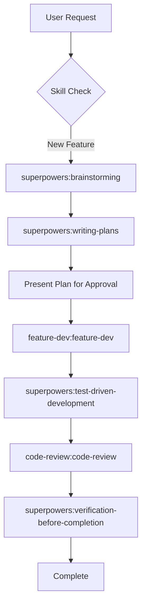
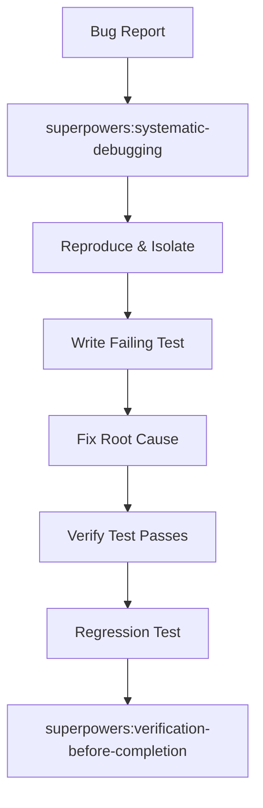
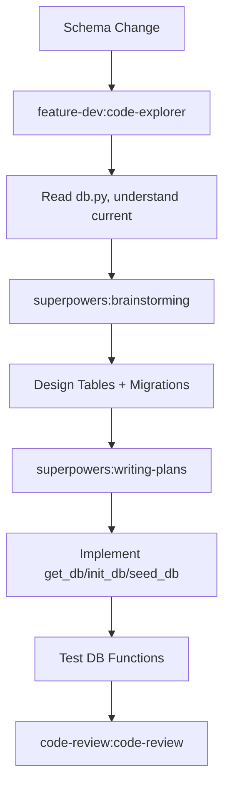
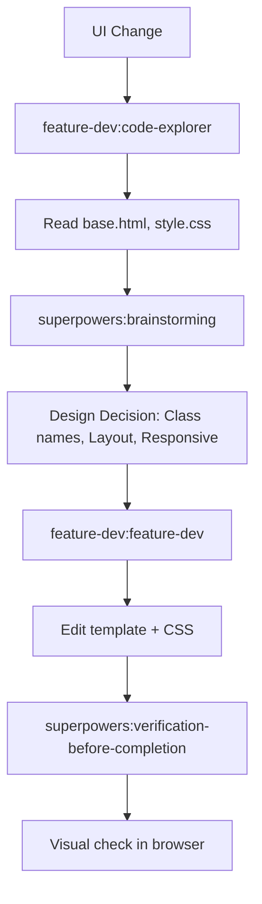
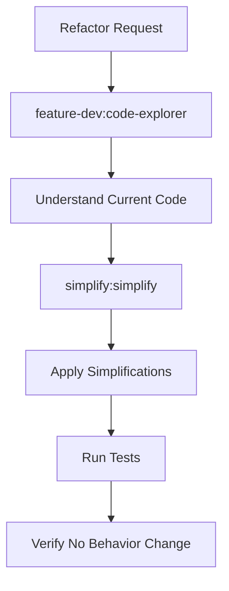

# Agentic Development Workflows for Spendly

## Workflow 1: New Feature Implementation

### Steps Detail

| Step | Agent/Tool | Output |
|------|------------|--------|
| 1 | `superpowers:brainstorming` | Design options, trade-offs, recommended approach |
| 2 | `superpowers:writing-plans` | Step-by-step implementation plan with success criteria |
| 3 | User | Approve / modify plan |
| 4 | `feature-dev:feature-dev` | Code changes across files |
| 5 | `superpowers:test-driven-development` | Tests written, passing |
| 6 | `code-review:code-review` | Findings (bugs, simplifications) |
| 7 | `superpowers:verification-before-completion` | App runs, tests pass, no regressions |

---

## Workflow 2: Bug Fix

### Steps Detail

| Step | Action |
|------|--------|
| 1 | `systematic-debugging` skill: gather symptoms, form hypotheses |
| 2 | Reproduce locally (run app, trigger bug) |
| 3 | Isolate to specific function/route |
| 4 | Write `pytest` test that fails |
| 5 | Fix minimal code to make test pass |
| 6 | Run full test suite (`pytest`) |
| 7 | Manual verify: `python app.py` → test in browser |

---

## Workflow 3: Database Schema Change (Step 1+)

---

## Workflow 4: Template/UI Change

---

## Workflow 5: Refactor / Code Cleanup

---

## Git Integration Points

| Workflow Stage | Git Action |
|----------------|------------|
| Plan approved | `git checkout -b feature/<name>` |
| Implementation | Commit per logical unit |
| Tests added | `git add tests/` |
| Review complete | `git commit -m "feat: <description>"` |
| Verification | `git push origin feature/<name>` |
| PR created | Link to GitHub PR |

---

## Success Criteria Checklist

Before marking ANY workflow complete:

- [ ] `pytest` passes (all tests)
- [ ] `python app.py` starts without errors
- [ ] Manual test: visit `http://localhost:5001`, test affected routes
- [ ] No unused imports/variables from your changes
- [ ] Style matches existing code (run `simplify` if needed)
- [ ] Git diff shows only intended changes

---

## Emergency Procedures

| Situation | Action |
|-----------|--------|
| Tests fail unexpectedly | `git stash` → run tests → if pass, your change broke it |
| App won't start | Check `app.py` syntax, port 5001 free, venv activated |
| DB errors | Delete `expense_tracker.db`, re-run `init_db()` |
| Merge conflicts | `git status`, resolve in favor of intended changes |